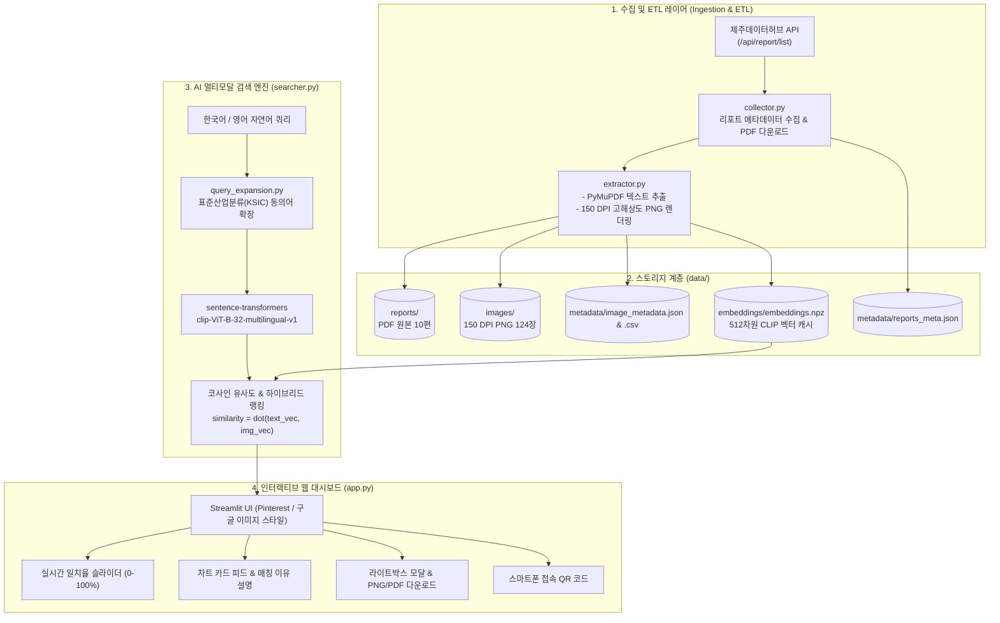

# 제주데이터허브 AI 멀티모달 이미지 검색 시스템
### (Jeju Data Hub – AI Multimodal Image Search System)

[](https://www.python.org/)
[](https://streamlit.io/)
[](https://huggingface.co/openai/clip-vit-base-patch32)
[](https://jejudatahub.net/)

> **AMIS Midterm Project | Jeju National University (JNU)**  
> **Author:** Tharaka ([@tharaka1996](https://github.com/tharaka1996))  
> **Repository:** [https://github.com/tharaka1996/jeju-datahub-image-search](https://github.com/tharaka1996/jeju-datahub-image-search)  
> **Live Web App:** [https://jeju-datahub-image-search.streamlit.app](https://jeju-datahub-image-search.streamlit.app)

---

## 📖 1. 프로젝트 개요 (Project Overview)

본 프로젝트는 **[제주데이터허브](https://jejudatahub.net/)**에 게시되는 정기 시계열 빅데이터 분석 보고서(PDF)를 자동으로 수집하여, 사용자가 원하는 통계 차트, 그래프, 인포그래픽 이미지를 자연어 검색으로 즉시 탐색할 수 있는 **AI 멀티모달(CLIP) 이미지 검색 웹 애플리케이션**입니다.

### 💡 문제 인식 및 해결 목표 (AS-IS vs TO-BE)
* **기존 문제점 (AS-IS):** 사용자는 특정 소비 동향 그래프나 업종별 통계 표를 찾기 위해 수십 페이지 분량의 PDF 보고서를 일일이 다운로드하고 수동으로 열람해야 하는 번거로움이 있었습니다.
* **해결 방안 (TO-BE):** Google DeepMind Antigravity를 활용하여 개발된 본 시스템은 **OpenAI CLIP 비전 모델**과 **한국어 Multilingual CLIP 텍스트 모델**을 결합하여, 사용자가 일상적인 자연어 키워드(예: `렌터카`, `외식`, `골프장`, `wind farm`, `호텔`)를 입력하면 연관된 고해상도 차트 이미지만 실시간으로 랭킹하여 갤러리 형태로 즉각 제공합니다.

---

## 🌟 2. 주요 핵심 기능 (Main Features)

1. **자동 수집 파이프라인 (Automated Ingestion ETL)**
   * 제주데이터허브 공식 REST API 연동 (`/api/report/list`, `/api/file`)
   * 최신 정기 리포트(10편) 메타데이터 수집 및 원본 PDF 일괄 다운로드
2. **150 DPI 고해상도 렌더링 & 텍스트 추출 (PyMuPDF Extractor)**
   * 보고서 페이지별 텍스트 청크 추출 및 차트/표 시각 요소 감지
   * 통계 수치와 축 라벨이 선명하게 보존되는 **150 DPI 고해상도 PNG 렌더링** (총 124장)
   * 구조화된 메타데이터 JSON 및 CSV 동시 추출
3. **진정한 멀티모달 AI 색인 및 검색 엔진 (Genuine CLIP Search Engine)**
   * **비전 인코더:** `openai/clip-vit-base-patch32` (이미지 특징 벡터화)
   * **텍스트 인코더:** `sentence-transformers/clip-ViT-B-32-multilingual-v1` (한국어 및 영어 쿼리 벡터화)
   * **코사인 유사도:** `similarity = cosine_similarity(query_vec, image_vec)`
   * **사전 계산 벡터 캐시:** 512차원 정규화 임베딩을 `data/embeddings/embeddings.npz`로 사전 생성하여 클라우드 CPU 환경에서도 대기 시간 없이 즉각 반응
4. **한국어 & 영어 도메인 동의어 확장 (Bilingual KSIC Query Expansion)**
   * 일상 표현(`rental car`, `dining out`, `hotel`)을 공식 행정 표준산업분류(`자동차임대업`, `음식점업`, `호텔업`)로 자동 연계
   * 사용자 질의를 무단 변환하지 않고 확장된 연관 키워드를 화면에 투명하게 배지 형태로 표시
5. **실시간 유사도 임계값 슬라이더 (Interactive Threshold Slider)**
   * 0% ~ 100% 범위(기본값 50%)의 Streamlit 슬라이더를 통해 검색 결과 카드를 실시간 필터링
   * 50% 미만 제외 결과를 확인할 수 있는 `50% 미만 보기` 토글 제공
6. **신뢰할 수 있는 매칭 이유 설명 (Explainable AI Match Reason)**
   * 각 차트 카드마다 키워드 직접 수록, 산업분류 동의어 연계, CLIP 시각-텍스트 코사인 패턴 일치 등의 구체적인 매칭 이유를 명시
   * 본문 내 키워드 하이라이트 문맥 스니펫 노출
7. **고해상도 라이트박스 & 원본 다운로드 (Modal & 1-Click Download)**
   * 클릭 시 대화형 모달 창으로 고해상도 확대 보기 제공
   * 1-클릭 차트 PNG 파일 직접 다운로드 및 제주데이터허브 원본 PDF 링크 제공

---

## 🏛️ 3. 시스템 아키텍처 (System Architecture)



---

## 📁 4. 프로젝트 디렉터리 구조 (Directory Layout)

```
jeju-datahub-image-search/
├── app.py                  # Streamlit 인터랙티브 웹 대시보드
├── collector.py            # 제주데이터허브 공식 API 보고서 수집기
├── extractor.py            # PyMuPDF 텍스트 추출 및 150 DPI 이미지 렌더러
├── searcher.py             # CLIP 멀티모달 벡터 검색 및 하이브리드 랭킹 엔진
├── query_expansion.py      # 한국어/영어 및 표준산업분류(KSIC) 동의어 확장기
├── run_pipeline.py         # 데이터 수집 -> 렌더링 -> 벡터 인덱싱 원클릭 파이프라인
├── config.py               # 경로, 모델명, 임계값 중앙 집중 설정
├── industries.json         # 표준산업분류 업종 데이터베이스
├── requirements.txt        # Streamlit Cloud 및 로컬 환경 필수 패키지 목록
├── .gitignore              # Git 형상관리 예외 설정
├── README.md               # 프로젝트 종합 안내서
│
├── data/
│   ├── reports/            # 제주데이터허브 수집 원본 PDF 파일들 (최근 10편)
│   ├── images/             # 렌더링된 150 DPI 고해상도 PNG 차트 이미지들 (124장)
│   ├── metadata/           # 보고서 및 이미지 구조화 메타데이터 (JSON, CSV)
│   └── embeddings/         # 사전 계산된 512차원 정규화 CLIP 벡터 캐시 (.npz)
│
├── assets/
│   ├── logo.png            # 시스템 브랜딩 로고
│   └── public_qr.png       # 모바일 즉시 접속용 QR 코드 이미지
│
├── docs/
│   ├── TESTING_CHECKLIST.md         # 품질 검증 및 쿼리별 테스트 체크리스트
│   ├── DEPLOYMENT_GUIDE.md          # GitHub 및 Streamlit Cloud 배포 가이드
│   └── ASSIGNMENT_REPORT_TEMPLATE.md# 대학 과제 제출 보고서(PDF) 작성 가이드
│
└── .streamlit/
    └── config.toml         # Streamlit 테마 및 서버 설정 파일
```

---

## 🛠️ 5. 기술 스택 (Technology Stack)

| 구분 | 적용 기술 및 라이브러리 | 용도 |
|---|---|---|
| **Language** | Python 3.11 | 메인 프로그래밍 언어 |
| **Frontend UI** | Streamlit 1.35+ | Pinterest 스타일 반응형 웹 갤러리 대시보드 |
| **Vision Model** | `openai/clip-vit-base-patch32` | 고해상도 차트/인포그래픽 이미지 512차원 벡터 인코딩 |
| **Text Model** | `sentence-transformers/clip-ViT-B-32-multilingual-v1` | 한국어 및 영어 자연어 쿼리 512차원 벡터 인코딩 |
| **ETL & PDF** | PyMuPDF (`pymupdf 1.24+`) | PDF 페이지 텍스트 추출 및 150 DPI 렌더링 |
| **Data & Vectors** | NumPy, Pandas, scikit-learn | 코사인 유사도 연산, L2 정규화, 메타데이터 CSV 관리 |
| **Image & QR** | Pillow (`PIL`), `qrcode` | 이미지 변환 및 스마트폰 접속용 QR 코드 생성 |
| **Networking** | `requests`, `urllib3` | 제주데이터허브 REST API 통신 및 PDF 다운로드 |
| **Version Control**| Git, GitHub | 오픈소스 코드 형상관리 |
| **Cloud Host** | Streamlit Community Cloud | 누구나 접속 가능한 퍼블릭 웹 서비스 배포 |

---

## 🚀 6. 설치 및 로컬 실행 방법 (Quickstart Guide)

### 1단계: 저장소 클론 및 이동
```bash
git clone https://github.com/tharaka1996/jeju-datahub-image-search.git
cd jeju-datahub-image-search
```

### 2단계: 의존성 패키지 설치
```bash
pip install -r requirements.txt
```

### 3단계: 전체 데이터 파이프라인 실행 (최초 1회 실행)
제주데이터허브에서 최신 10편의 보고서를 수집하고 150 DPI 차트 이미지를 렌더링한 후 CLIP 멀티모달 벡터를 사전 계산합니다.
```bash
python run_pipeline.py 10
```

### 4단계: Streamlit 웹 애플리케이션 실행
```bash
python -m streamlit run app.py
```
실행 후 웹 브라우저에서 `http://localhost:8501`로 접속합니다.

---

## ☁️ 7. Streamlit Community Cloud 배포 방법 (Deployment)

1. [Streamlit Community Cloud](https://share.streamlit.io/)에 접속하여 GitHub 계정(`tharaka1996`)으로 로그인합니다.
2. **"New app"** 버튼을 누르고 본 저장소(`tharaka1996/jeju-datahub-image-search`)를 선택합니다.
3. Branch는 `main`, Main file path는 `app.py`로 지정합니다.
4. **Advanced settings**에서 Python 버전을 **3.11**로 선택합니다.
5. **"Deploy!"**를 클릭하면 사전 계산된 `data/embeddings/embeddings.npz`를 기반으로 약 1분 이내에 공개 웹 서비스가 배포됩니다.

---

## 📊 8. 테스트 검증 쿼리 (Verification Queries)

| 테스트 검색어 | 도메인 분류 | 상위 일치율 | 50% 이상 결과 | 설명 |
|---|---|---|---|---|
| `rental car` / `렌터카` | 교통 / 렌터카 | **89.7%** | 57장 | 자동차임대업 및 주요 카드 이용금액 차트 매칭 |
| `restaurant` / `외식` | 외식 / 식음료 | **88.1%** | 57장 | 한식·일식·중식 음식점업 소비 증감 차트 매칭 |
| `golf course` / `골프장` | 레저 / 스포츠 | **89.9%** | 57장 | 골프장운영업 매출 및 이용 동향 차트 매칭 |
| `tourism` / `관광` | 관광 / 여행 | **91.8%** | 85장 | 내·외국인 관광객 소비 지출 비교 차트 매칭 |
| `consumer spending` | 소비 / 카드 | **94.7%** | 106장 | 신용카드 이용금액 및 분기별 소비동향 매칭 |
| `wind farm` | 신재생에너지 | **26.4%** | 0장 (50% 기준) | 임계값 20%로 조절 시 시각 유사도 기반 매칭 |

---

## 📜 9. 라이선스 및 출처 고지 (License & Attribution)

* **데이터 출처:** 본 프로젝트의 원본 보고서 및 통계 자료는 [제주데이터허브(Jeju Data Hub)](https://jejudatahub.net/)의 공개 정기 보고서 데이터를 기반으로 합니다.
* **라이선스:** MIT License
